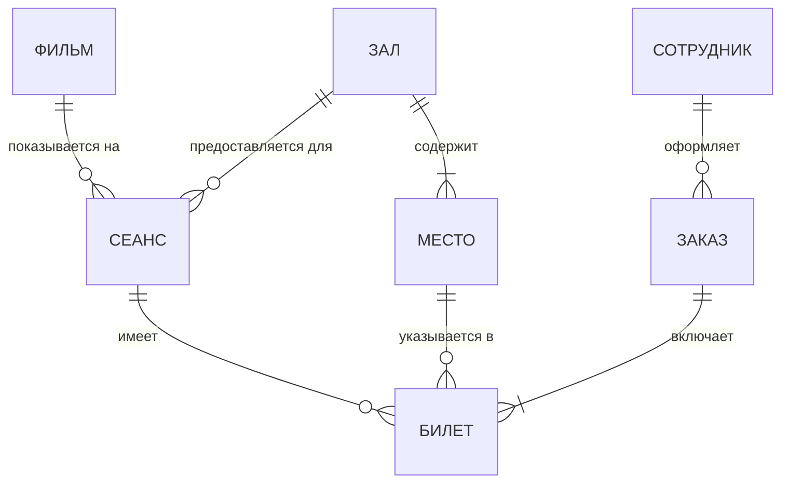

# 1. Внешняя модель предметной области кинотеатра

Внешняя модель описывает работу кинотеатра с точки зрения его сотрудников до разработки информационной системы. В этой главе рассматриваются действия администратора и кассира, необходимые им сведения, правила работы и документы, которые они подготавливают.

## 1.1. Описание объектов предметной области, их свойств и связей между объектами

### Представление администратора

Администратор организует показы фильмов и контролирует работу кинотеатра. Для каждого фильма он указывает прокатное название, жанр, продолжительность, возрастное ограничение, краткое описание и сведения о прокатном периоде. Фильм получает прокатный код, который не повторяется у других фильмов.

Администратор ведет сведения о кинозалах: название или номер зала, вместимость, количество рядов и описание расположения мест. В каждом зале места имеют ряд и порядковый номер. В пределах одного зала сочетание ряда и номера места не повторяется.

Для показа фильма администратор назначает сеанс. Сеанс характеризуется своим номером, фильмом, залом, датой и временем начала, установленной ценой и состоянием (запланирован, отменен или завершен). Один фильм может демонстрироваться на многих сеансах, а в одном сеансе показывается один фильм. Один зал используется для разных сеансов в разное время.

Администратор проверяет расписание, чтобы показы в одном зале не пересекались, и контролирует доступность билетов. Он также подготавливает сведения о работе кинотеатра за выбранный период.

### Представление кассира

Кассир обслуживает посетителей, сообщает им о фильмах и сеансах, показывает доступные места и оформляет продажу билетов. Для продажи он выбирает сеанс и места, указывает данные посетителя, если они необходимы для оформления, и принимает оплату. Каждому оформленному билету присваивается номер. Билет содержит сведения о фильме, дате и времени сеанса, зале, месте и цене.

При продаже кассир оформляет заказ. Заказ имеет номер, дату и время оформления, состав билетов, общую сумму, способ оплаты и состояние (создан, оплачен или отменен).

Кассир может найти заказ по его номеру или билету. Проданное место нельзя продать повторно на тот же сеанс. Кассир ведет учет совершенных продаж и готовит отчет о кассовых операциях за смену.

### Связи между объектами

Фильм демонстрируется на одном или нескольких сеансах. Каждый сеанс проходит в одном кинозале и относится к одному фильму. Кинозал включает места, каждое из которых имеет свой ряд и порядковый номер. На сеансе билет оформляется на конкретное место. Один заказ может включать несколько билетов, а каждый билет относится к одному заказу. Сотрудник оформляет продажи в рамках своей смены.

## 1.2. Описание ограничений предметной области

В работе кинотеатра действуют следующие ограничения и правила:

- прокатный код фильма, номер сеанса, номер заказа и номер билета не повторяются;
- ряд и порядковый номер места вместе однозначно определяют место в конкретном зале;
- фильм, зал, место, сеанс, заказ и билет должны иметь заполненные обязательные сведения;
- сеанс относится только к одному фильму и одному залу;
- начало сеанса должно быть раньше его окончания, а сеанс должен проходить в рабочее время кинотеатра;
- сеансы одного зала не пересекаются по времени;
- билет оформляется на один сеанс и одно место;
- одно и то же место нельзя продать нескольким посетителям на один сеанс;
- число проданных мест не может превышать количество мест в зале;
- отмененный сеанс не обслуживается;
- сумма заказа равна сумме входящих в него билетов;
- данные о завершенных продажах сохраняются, даже если расписание или сведения о фильме позднее изменились.


## 1.3. Описание способов и форм обработки информации

Администратор просматривает перечень фильмов, залов и сеансов, добавляет и изменяет сведения, формирует расписание, проверяет занятость залов и анализирует продажи. Кассир ищет фильм или сеанс по названию и дате, уточняет свободные места, оформляет заказ, печатает или выдает билет, находит ранее оформленный заказ.

Результаты обработки представляются в виде текстовых отчетов. Их формируют администратор и кассир, после чего при необходимости сохраняют или печатают с помощью текстового редактора.

### Макет отчета 1. Расписание сеансов

**Пользователь:** администратор.  
**Период:** дата или диапазон дат.

| Дата | Время начала | Фильм | Возрастное ограничение | Зал | Свободно мест | Цена билета | Состояние |
|---|---|---|---|---|---:|---:|---|
|  |  |  |  |  |  |  |

Отчет позволяет проверить план показов, загрузку залов и наличие свободных мест.

### Макет отчета 2. Продажи за смену

**Пользователь:** кассир.  
**Период:** одна рабочая смена.

| Время продажи | Номер заказа | Фильм и сеанс | Места | Способ оплаты | Сумма | Сотрудник |
|---|---|---|---|---|---|---:|---|
|  |  |  |  |  |  |  |

В конце отчета указываются общее число проданных билетов и итоговая сумма за смену.

### Макет отчета 3. Посещаемость и выручка по сеансам

**Пользователь:** администратор.  
**Период:** выбранная дата или диапазон дат.

| Дата и время | Фильм | Зал | Вместимость | Продано билетов | Заполняемость, % | Выручка |
|---|---|---|---:|---:|---:|---:|
|  |  |  |  |  |  |  |

В отчете приводятся итоги по каждому сеансу и общие итоги за выбранный период. Выручка рассчитывается по оплаченным билетам.

## 1.4. Дополнительные требования

Сведения об афише, расписании, свободных местах и продажах должны быть актуальными на момент обслуживания посетителя. Сотрудники должны иметь возможность быстро найти фильм, сеанс, заказ или билет по характерным для работы кинотеатра сведениям: названию, дате, времени, номеру заказа или билета.

Продажу одного места нескольким посетителям необходимо исключить, в том числе при одновременном обслуживании несколькими кассирами. Действия сотрудников, влияющие на расписание и продажи, должны быть прослеживаемыми: для операции сохраняются время и ответственный сотрудник.

Перечень фильмов и расписание меняются регулярно, поэтому изменение таких сведений должно быть удобным и не требовать повторного ввода данных о залах и местах. Название кинотеатра, его адрес, рабочие часы и иные общие параметры задаются отдельно и могут изменяться уполномоченным сотрудником.

При оформлении заказа сотруднику необходимо получать понятное подтверждение выбранных фильма, сеанса, мест и общей стоимости. Если выбранное место уже занято или сеанс отменен, кассир должен быть своевременно уведомлен и иметь возможность выбрать другой вариант.

## 1.5. Модель предметной области в виде схемы «Объекты — связи»

На схеме показаны основные объекты, рассматриваемые администратором и кассиром, и связи между ними.



Связь билета с сеансом и местом означает, что место рассматривается применительно к конкретному показу. Поэтому занятость места определяется сочетанием сеанса и места, а не только номером места в зале.

# 2. Логическая (концептуальная) модель предметной области кинотеатра

Внешняя модель из главы 1 преобразуется в логическую модель: сведения о фильмах, залах, сеансах, местах, заказах и билетах представляются базовыми отношениями. Ниже используются обозначения реляционной алгебры и функциональных зависимостей. Операторы SQL не применяются. Для однозначности приняты допущения: каждый сеанс имеет уникальный номер; каждый билет относится к одному месту одного сеанса; один заказ может включать несколько билетов; сотрудник, оформивший заказ, известен.

Обозначения: `PK` — выбранный первичный ключ; `FK` — внешний ключ; `U` — альтернативная уникальность. Имена атрибутов в модели записаны без пробелов.

## 2.1. Схемы базовых отношений

Схемы отношений задают атрибуты, необходимые для поддержки сценариев главы 1 и формирования указанных там отчетов.

1. **ФИЛЬМ**(`КодФильма`, `Название`, `Жанр`, `ПродолжительностьМин`, `ВозрастноеОграничение`, `Описание`, `НачалоПроката`, `КонецПроката`), `PK` = `КодФильма`.
2. **ЗАЛ**(`НомерЗала`, `НазваниеЗала`, `КоличествоРядов`, `Вместимость`), `PK` = `НомерЗала`.
3. **МЕСТО**(`НомерЗала`, `Ряд`, `НомерМеста`, `КатегорияМеста`), `PK` = (`НомерЗала`, `Ряд`, `НомерМеста`), `FK` `НомерЗала` → ЗАЛ.
4. **СОТРУДНИК**(`ТабельныйНомер`, `Фамилия`, `Имя`, `Должность`), `PK` = `ТабельныйНомер`.
5. **СЕАНС**(`НомерСеанса`, `КодФильма`, `НомерЗала`, `ДатаВремяНачала`, `ЦенаБилета`, `Состояние`), `PK` = `НомерСеанса`; `FK` `КодФильма` → ФИЛЬМ; `FK` `НомерЗала` → ЗАЛ.
6. **ЗАКАЗ**(`НомерЗаказа`, `ДатаВремяОформления`, `ТабельныйНомер`, `СпособОплаты`, `Состояние`), `PK` = `НомерЗаказа`; `FK` `ТабельныйНомер` → СОТРУДНИК.
7. **БИЛЕТ**(`НомерБилета`, `НомерЗаказа`, `НомерСеанса`, `НомерЗала`, `Ряд`, `НомерМеста`, `ЦенаПродажи`, `СостояниеБилета`), `PK` = `НомерБилета`; `FK` `НомерЗаказа` → ЗАКАЗ; `FK` `НомерСеанса` → СЕАНС; `FK` (`НомерЗала`, `Ряд`, `НомерМеста`) → МЕСТО; `U` = (`НомерСеанса`, `НомерЗала`, `Ряд`, `НомерМеста`).

В БИЛЕТ хранится зал, чтобы внешний ключ на конкретное место можно было задать непосредственно. Целостность требует, чтобы номер зала билета совпадал с залом сеанса. Это межотношенческое условие отдельно включено в предикат целостности в п. 2.10. Вместимость зала является производным итогом числа записей МЕСТО; при загрузке системы она должна совпадать с числом заведенных мест.

## 2.2. Домены атрибутов отношений

Домен задает допустимый тип и область значений атрибута. Все строковые значения хранятся в кодировке Unicode; длины ниже являются проектными ограничениями.

| Атрибуты | Домен |
|---|---|
| `КодФильма` | Положительное целое число, уникальное в ФИЛЬМ |
| `Название`, `НазваниеЗала` | Строка Unicode длиной 1–200 символов, не пустая |
| `Жанр` | Строка Unicode длиной 1–80 символов |
| `ПродолжительностьМин` | Целое число от 1 до 600 |
| `ВозрастноеОграничение` | Одно из значений: 0+, 6+, 12+, 16+, 18+ |
| `Описание` | Строка Unicode длиной до 2000 символов; может отсутствовать |
| `НачалоПроката`, `КонецПроката` | Календарная дата; граница проката может отсутствовать |
| `НомерЗала`, `НомерСеанса`, `НомерЗаказа`, `НомерБилета` | Положительное целое число, уникальное в соответствующем отношении |
| `КоличествоРядов`, `Вместимость`, `Ряд`, `НомерМеста` | Положительное целое число |
| `КатегорияМеста` | Строка Unicode длиной 1–40 символов |
| `Фамилия`, `Имя` | Строка Unicode длиной 1–100 символов, не пустая |
| `Должность` | Строка Unicode длиной 1–80 символов |
| `ТабельныйНомер` | Положительное целое число, уникальное в СОТРУДНИК |
| `ДатаВремяНачала`, `ДатаВремяОформления` | Дата и время с точностью до минуты |
| `ЦенаБилета`, `ЦенаПродажи` | Денежное число в рублях с точностью до копейки, неотрицательное |
| `Состояние` сеанса | Одно из значений: запланирован, отменен, завершен |
| `Состояние` заказа | Одно из значений: создан, оплачен, отменен |
| `СостояниеБилета` | Одно из значений: оплачен, аннулирован |
| `СпособОплаты` | Одно из значений: наличные, банковская карта, онлайн; до оплаты может отсутствовать |

При реализации одноименные атрибуты `Состояние` сеанса и заказа трактуются по разным доменам.

## 2.3. Множество функциональных зависимостей

Функциональная зависимость `X → Y` означает, что одинаковые значения атрибутов `X` в отношении требуют одинаковых значений атрибутов `Y`. Для базовых отношений принимаются следующие зависимости:

- ФИЛЬМ: `КодФильма → Название, Жанр, ПродолжительностьМин, ВозрастноеОграничение, Описание, НачалоПроката, КонецПроката`.
- ЗАЛ: `НомерЗала → НазваниеЗала, КоличествоРядов, Вместимость`.
- МЕСТО: `(НомерЗала, Ряд, НомерМеста) → КатегорияМеста`.
- СОТРУДНИК: `ТабельныйНомер → Фамилия, Имя, Должность`.
- СЕАНС: `НомерСеанса → КодФильма, НомерЗала, ДатаВремяНачала, ЦенаБилета, Состояние`.
- ЗАКАЗ: `НомерЗаказа → ДатаВремяОформления, ТабельныйНомер, СпособОплаты, Состояние`.
- БИЛЕТ: `НомерБилета → НомерЗаказа, НомерСеанса, НомерЗала, Ряд, НомерМеста, ЦенаПродажи, СостояниеБилета`.
- БИЛЕТ: `(НомерСеанса, НомерЗала, Ряд, НомерМеста) → НомерБилета, НомерЗаказа, ЦенаПродажи, СостояниеБилета`.

Общая сумма заказа вычисляется по стоимости входящих в него билетов и отдельно не хранится.

## 2.4. Неприводимое множество функциональных зависимостей

Неприводимое покрытие `F_min` получается разбиением правых частей на одиночные атрибуты. Левые части минимальны, так как в составной зависимости БИЛЕТ удаление любого атрибута уничтожает определение конкретного места на конкретном сеансе.

- **ФИЛЬМ:** `КодФильма → Название`; `КодФильма → Жанр`; `КодФильма → ПродолжительностьМин`; `КодФильма → ВозрастноеОграничение`; `КодФильма → Описание`; `КодФильма → НачалоПроката`; `КодФильма → КонецПроката`.
- **ЗАЛ:** `НомерЗала → НазваниеЗала`; `НомерЗала → КоличествоРядов`; `НомерЗала → Вместимость`.
- **МЕСТО:** `(НомерЗала, Ряд, НомерМеста) → КатегорияМеста`.
- **СОТРУДНИК:** `ТабельныйНомер → Фамилия`; `ТабельныйНомер → Имя`; `ТабельныйНомер → Должность`.
- **СЕАНС:** `НомерСеанса → КодФильма`; `НомерСеанса → НомерЗала`; `НомерСеанса → ДатаВремяНачала`; `НомерСеанса → ЦенаБилета`; `НомерСеанса → Состояние`.
- **ЗАКАЗ:** `НомерЗаказа → ДатаВремяОформления`; `НомерЗаказа → ТабельныйНомер`; `НомерЗаказа → СпособОплаты`; `НомерЗаказа → Состояние`.
- **БИЛЕТ:** `НомерБилета → НомерЗаказа`; `НомерБилета → НомерСеанса`; `НомерБилета → НомерЗала`; `НомерБилета → Ряд`; `НомерБилета → НомерМеста`; `НомерБилета → ЦенаПродажи`; `НомерБилета → СостояниеБилета`; `(НомерСеанса, НомерЗала, Ряд, НомерМеста) → НомерБилета`; `(НомерСеанса, НомерЗала, Ряд, НомерМеста) → НомерЗаказа`; `(НомерСеанса, НомерЗала, Ряд, НомерМеста) → ЦенаПродажи`; `(НомерСеанса, НомерЗала, Ряд, НомерМеста) → СостояниеБилета`.

## 2.5. Множество суперключей отношения БИЛЕТ

Рассмотрим отношение БИЛЕТ с атрибутами `U = {НомерБилета, НомерЗаказа, НомерСеанса, НомерЗала, Ряд, НомерМеста, ЦенаПродажи, СостояниеБилета}`. Его минимальные определяющие множества (потенциальные ключи) — `{НомерБилета}` и `{НомерСеанса, НомерЗала, Ряд, НомерМеста}`. Второе множество составное и содержит более трех атрибутов.

Множество всех суперключей задается как:

`SK(БИЛЕТ) = {X ⊆ U | НомерБилета ∈ X} ∪ {X ⊆ U | {НомерСеанса, НомерЗала, Ряд, НомерМеста} ⊆ X}`.

То есть суперключом является любое надмножество номера билета либо любого надмножества полного сочетания номера сеанса, зала, ряда и места. Например, `{НомерБилета, ЦенаПродажи}` и `{НомерСеанса, НомерЗала, Ряд, НомерМеста, НомерЗаказа}` — суперключи; `{НомерСеанса, НомерЗала, Ряд}` — не суперключ.

## 2.6. Потенциальные ключи отношения БИЛЕТ и доказательство их потенциальности

Из множества суперключей выбираются минимальные по включению множества. Получаем:

- `K₁ = {НомерБилета}`;
- `K₂ = {НомерСеанса, НомерЗала, Ряд, НомерМеста}`.

Докажем уникальность составного ключа `K₂` по функциональным зависимостям отношения БИЛЕТ. Обозначим замыкание множества атрибутов `X` через `X⁺`. Начинаем с:

`K₂⁺ = {НомерСеанса, НомерЗала, Ряд, НомерМеста}`.

По зависимости составного места получаем `НомерБилета`, `НомерЗаказа`, `ЦенаПродажи` и `СостояниеБилета`. Следовательно:

`K₂⁺ = {НомерБилета, НомерЗаказа, НомерСеанса, НомерЗала, Ряд, НомерМеста, ЦенаПродажи, СостояниеБилета} = U`.

Значит, `K₂` определяет все атрибуты отношения и является суперключом, то есть обеспечивает уникальность строки. Проверим неизбыточность удалением каждого атрибута:

- без `НомерСеанса` нельзя получить номер билета, так как зависимость от сочетания начинается именно с номера сеанса; `НомерБилета` и другие атрибуты не выводятся;
- без `НомерЗала` невозможно определить билет по оставшимся атрибутам;
- без `Ряд` невозможно определить билет по оставшимся атрибутам;
- без `НомерМеста` невозможно определить билет по оставшимся атрибутам.

Ни одно собственное подмножество `K₂` не является суперключом, поэтому ключ неизбыточен и потенциальен. Для `K₁` замыкание равно `U` по зависимости от номера билета, а его единственное собственное подмножество — пустое множество, которое не определяет атрибуты отношения. Следовательно, `K₁` также является потенциальным ключом.

## 2.7. Выбор первичных ключей

В качестве первичных выбраны следующие потенциальные ключи:

| Отношение | Первичный ключ | Обоснование |
|---|---|---|
| ФИЛЬМ | `КодФильма` | Короткий, неизменяемый код; название может изменяться |
| ЗАЛ | `НомерЗала` | Номер однозначно обозначает зал |
| МЕСТО | (`НомерЗала`, `Ряд`, `НомерМеста`) | Место определяется только внутри конкретного зала |
| СОТРУДНИК | `ТабельныйНомер` | Табельный номер уникален и не зависит от фамилии |
| СЕАНС | `НомерСеанса` | Уникальный номер остается стабильным при изменении расписания |
| ЗАКАЗ | `НомерЗаказа` | Номер удобен для поиска заказа |
| БИЛЕТ | `НомерБилета` | Уникальный номер удобен для проверки билета; сочетание сеанса и места остается альтернативным уникальным ограничением |

Для МЕСТО составной ключ соответствует фактическому правилу нумерации кресел. В БИЛЕТ выбран простой первичный ключ для удобства ссылок; альтернативный потенциальный ключ предотвращает двойную продажу одного места.

## 2.8. Обоснование внешних ключей

| Отношение и атрибуты | Ссылается на | Обоснование |
|---|---|---|
| МЕСТО.`НомерЗала` | ЗАЛ.`НомерЗала` | Место может находиться только в существующем зале |
| СЕАНС.`КодФильма` | ФИЛЬМ.`КодФильма` | Для сеанса должен быть заведён показываемый фильм |
| СЕАНС.`НомерЗала` | ЗАЛ.`НомерЗала` | Сеанс назначается в существующий зал |
| ЗАКАЗ.`ТабельныйНомер` | СОТРУДНИК.`ТабельныйНомер` | За заказ отвечает зарегистрированный сотрудник |
| БИЛЕТ.`НомерЗаказа` | ЗАКАЗ.`НомерЗаказа` | Билет входит в существующий заказ |
| БИЛЕТ.`НомерСеанса` | СЕАНС.`НомерСеанса` | Билет относится к существующему сеансу |
| БИЛЕТ.(`НомерЗала`, `Ряд`, `НомерМеста`) | МЕСТО.(`НомерЗала`, `Ряд`, `НомерМеста`) | Билет оформляется на существующее место |

Дополнительно проверяется равенство `БИЛЕТ.НомерЗала = СЕАНС.НомерЗала` для указанного в билете сеанса. Это межотношенческое условие нельзя выразить одним внешним ключом.

## 2.9. Нормализация отношения с данными о билетах

Для демонстрации нормализации рассмотрим исходное отношение `БИЛЕТНЫЙ_ОТЧЕТ`, предназначенное для учета продажи места и подготовки кассовой и сеансовой отчетности:

`БИЛЕТНЫЙ_ОТЧЕТ(НомерСеанса, НомерЗала, Ряд, НомерМеста, НомерБилета, НомерЗаказа, ДатаВремяОформления, ТабельныйНомер, ФамилияСотрудника, КодФильма, НазваниеФильма, ПродолжительностьМин, ДатаВремяНачала, ЦенаПродажи, СостояниеБилета)`.

Принимаются зависимости:

1. `(НомерСеанса, НомерЗала, Ряд, НомерМеста) → НомерБилета, НомерЗаказа, ЦенаПродажи, СостояниеБилета`;
2. `НомерБилета → НомерСеанса, НомерЗала, Ряд, НомерМеста, НомерЗаказа, ЦенаПродажи, СостояниеБилета`;
3. `НомерЗаказа → ДатаВремяОформления, ТабельныйНомер`;
4. `ТабельныйНомер → ФамилияСотрудника`;
5. `НомерСеанса → КодФильма, ДатаВремяНачала`;
6. `КодФильма → НазваниеФильма, ПродолжительностьМин`.

Кандидатными ключами исходного отношения являются `НомерБилета` и сочетание `(НомерСеанса, НомерЗала, Ряд, НомерМеста)`. Для демонстрации составной ключ выбираем первичный ключ `K = (НомерСеанса, НомерЗала, Ряд, НомерМеста)`: сочетание соответствует правилу, по которому одно место на одном сеансе может быть продано только один раз. `НомерБилета` сохраняет роль альтернативного потенциального ключа.

### Первая нормальная форма

Отношение находится в 1НФ, если каждое поле содержит одно неделимое значение. В исходном отношении атрибуты атомарны, а повторяющиеся билеты представлены отдельными строками. Следовательно, отношение уже находится в 1НФ; его схема остается такой, как указана выше. Первичный ключ — составной `K`.

В этой форме присутствуют аномалии. Зависимость `НомерСеанса → КодФильма, ДатаВремяНачала` идет от части составного ключа, а не от полного ключа. Поэтому сведения о фильме и времени сеанса повторяются для всех билетов этого сеанса. Переименование фильма требует исправления многих строк; удаление последнего билета может удалить единственную сохраненную копию сведений о сеансе. Дополнительно имеются транзитивные зависимости `НомерЗаказа → ТабельныйНомер → ФамилияСотрудника` и `НомерСеанса → КодФильма → НазваниеФильма, ПродолжительностьМин`.

### Переход ко второй нормальной форме

Для устранения зависимостей неключевых атрибутов от части первичного ключа выполняем проекции, сохраняя исходные зависимости:

- **БИЛЕТ_2НФ**(`НомерБилета`, `НомерЗаказа`, `НомерСеанса`, `НомерЗала`, `Ряд`, `НомерМеста`, `ЦенаПродажи`, `СостояниеБилета`). Первичный ключ — `НомерБилета`; альтернативный ключ — (`НомерСеанса`, `НомерЗала`, `Ряд`, `НомерМеста`). Атрибуты заказа и продажи зависят от номера билета целиком, а ограничение на уникальность места задано альтернативным ключом.
- **СЕАНС_2НФ**(`НомерСеанса`, `КодФильма`, `НазваниеФильма`, `ПродолжительностьМин`, `ДатаВремяНачала`, `НомерЗала`). Первичный ключ — `НомерСеанса`, поскольку он определяет все сведения о сеансе.
- **ЗАКАЗ_2НФ**(`НомерЗаказа`, `ДатаВремяОформления`, `ТабельныйНомер`, `ФамилияСотрудника`). Первичный ключ — `НомерЗаказа`, поскольку он определяет сведения об оформлении заказа.

Отношение БИЛЕТ_2НФ не содержит неключевых атрибутов, зависящих от части составного ключа: в нем сохранены только характеристики билета, определяемые его номером, и альтернативное сочетание сеанса и места. СЕАНС_2НФ и ЗАКАЗ_2НФ имеют одноатрибутные ключи, поэтому частичных зависимостей в них нет. Все зависимости исходного отношения сохраняются в одной из трех проекций: связи билета с заказом и местом — в БИЛЕТ_2НФ, сведения сеанса — в СЕАНС_2НФ, сведения заказа и сотрудника — в ЗАКАЗ_2НФ.

Однако в СЕАНС_2НФ остается транзитивная зависимость `НомерСеанса → КодФильма → НазваниеФильма, ПродолжительностьМин`, а в ЗАКАЗ_2НФ — `НомерЗаказа → ТабельныйНомер → ФамилияСотрудника`. Поэтому в 2НФ сохраняются аномалии обновления, вставки и удаления сведений о фильмах и сотрудниках.

### Переход к третьей нормальной форме

Декомпозируем СЕАНС_2НФ и ЗАКАЗ_2НФ по транзитивным зависимостям:

- **БИЛЕТ**(`НомерБилета`, `НомерЗаказа`, `НомерСеанса`, `НомерЗала`, `Ряд`, `НомерМеста`, `ЦенаПродажи`, `СостояниеБилета`). Первичный ключ — `НомерБилета`; альтернативный — (`НомерСеанса`, `НомерЗала`, `Ряд`, `НомерМеста`).
- **СЕАНС**(`НомерСеанса`, `КодФильма`, `ДатаВремяНачала`, `НомерЗала`). Первичный ключ — `НомерСеанса`.
- **ФИЛЬМ**(`КодФильма`, `НазваниеФильма`, `ПродолжительностьМин`). Первичный ключ — `КодФильма`.
- **ЗАКАЗ**(`НомерЗаказа`, `ДатаВремяОформления`, `ТабельныйНомер`). Первичный ключ — `НомерЗаказа`.
- **СОТРУДНИК**(`ТабельныйНомер`, `ФамилияСотрудника`). Первичный ключ — `ТабельныйНомер`.

В каждой проекции неключевые атрибуты зависят от ключа, от всего ключа и ни от чего, кроме ключа. Декомпозиция сохраняет зависимости: каждая исходная зависимость содержится в одной из полученных проекций. Она является без потерь, поскольку отношения соединяются по сохраненным ключам `НомерБилета`, `НомерСеанса`, `КодФильма`, `НомерЗаказа` и `ТабельныйНомер`. Полученные отношения находятся как минимум в 3НФ. В полном перечне базовых отношений сведения ФИЛЬМ, СОТРУДНИК и ЗАКАЗ расширяются дополнительными атрибутами из п. 2.1; первичные ключи остаются теми же.

## 2.10. Предикат целостности базы данных

Состояние базы данных допустимо тогда и только тогда, когда одновременно выполняются следующие условия:

1. Первичные ключи заполнены, а все значения принадлежат доменам из п. 2.2.
2. Все внешние ключи из п. 2.8 ссылаются на существующие кортежи.
3. В МЕСТО уникально сочетание (`НомерЗала`, `Ряд`, `НомерМеста`); число мест не превышает вместимость зала и после полного заполнения справочника совпадает с ней.
4. Для каждого сеанса существуют фильм и зал; время начала раньше времени окончания показа, а сеанс находится в пределах рабочего времени кинотеатра.
5. Интервалы двух сеансов одного зала не пересекаются.
6. В БИЛЕТ сочетание (`НомерСеанса`, `НомерЗала`, `Ряд`, `НомерМеста`) уникально, а зал билета совпадает с залом сеанса.
7. Цена билета неотрицательна; билет относится к существующему заказу и месту зала, назначенного на сеанс.
8. Для оплаченного заказа указан способ оплаты, а его сумма равна сумме цен входящих в него билетов.

Формально предикат представляется конъюнкцией: `Целостность = Домены ∧ Уникальность ∧ СсылочнаяЦелостность ∧ Расписание ∧ БилетныеОграничения ∧ ДенежныеОграничения`.

## 2.11. Требуемые виртуальные отношения

Виртуальное отношение — результат выборки и объединения базовых отношений, используемый для отчета без дублирования исходных данных. Для отчетов п. 1.3 требуются следующие структуры:

1. **АФИША_СВОБОДНЫЕ_МЕСТА**(`Дата`, `ВремяНачала`, `НазваниеФильма`, `ВозрастноеОграничение`, `НомерСеанса`, `НазваниеЗала`, `Вместимость`, `ЗанятоМест`, `СвободноМест`, `ЦенаБилета`, `СостояниеСеанса`). Формируется из СЕАНС, ФИЛЬМ, ЗАЛ и оплаченных БИЛЕТ с расчетом занятых мест.
2. **ПРОДАЖИ_КАССИРА**(`ДатаВремяПродажи`, `НомерЗаказа`, `НомерБилета`, `НазваниеФильма`, `ДатаВремяСеанса`, `НомерЗала`, `Ряд`, `НомерМеста`, `СпособОплаты`, `Сумма`, `ФамилияСотрудника`). Включает продажи за интервал смены.
3. **ИТОГИ_СЕАНСОВ**(`ДатаВремяСеанса`, `НазваниеФильма`, `НомерЗала`, `Вместимость`, `ПроданоБилетов`, `ЗаполняемостьПроц`, `Выручка`). Строится из сведений о сеансах, залах и оплаченных билетах с группировкой по сеансу.

Параметры периода и смены задаются пользователем при формировании отчета.

## 2.12. Реляционные выражения для построения отчетов

Используются обозначения реляционной алгебры: `σ` — выборка; `π` — проекция; `⋈` — соединение; `γ` — группировка и агрегирование. В выражениях предполагаются естественные соединения по одноименным атрибутам; если имена атрибутов различаются, применяется соединение по равенству соответствующих атрибутов.

### Выражение для отчета «Расписание сеансов»

`ЗАНЯТОСТЬ = γ_{НомерСеанса; COUNT(НомерБилета)→ЗанятоМест}(σ_{СостояниеБилета=«оплачен»}(БИЛЕТ))`.

`РАСПИСАНИЕ = π_{ДатаВремяНачала→ДатаИВремя, Название→НазваниеФильма, ВозрастноеОграничение, НомерСеанса, НазваниеЗала, Вместимость, Вместимость−ЗанятоМест→СвободноМест, ЦенаБилета, Состояние}(СЕАНС ⋈ ФИЛЬМ ⋈ ЗАЛ ⋈ ЗАНЯТОСТЬ)`.

Результат ограничивается выбранным диапазоном дат. Для сеансов без проданных билетов число занятых мест принимается равным нулю.

### Выражение для отчета «Продажи за смену»

`ПРОДАЖИ_КАССИРА = π_{ДатаВремяОформления→ДатаВремяПродажи, НомерЗаказа, НомерБилета, Название→НазваниеФильма, ДатаВремяНачала→ДатаВремяСеанса, НомерЗала, Ряд, НомерМеста, СпособОплаты, ЦенаПродажи→Сумма, Фамилия}(σ_{ЗАКАЗ.Состояние=«оплачен»}(ЗАКАЗ ⋈ БИЛЕТ ⋈ СЕАНС ⋈ ФИЛЬМ ⋈ СОТРУДНИК))`.

К результату применяется выборка по интервалу смены. Группировка по смене позволяет вычислить число проданных билетов и общую сумму.

### Выражение для отчета «Посещаемость и выручка по сеансам»

`ПРОДАНО = γ_{НомерСеанса; COUNT(НомерБилета)→ПроданоБилетов, SUM(ЦенаПродажи)→Выручка}(σ_{СостояниеБилета=«оплачен»}(БИЛЕТ))`.

`ИТОГИ_СЕАНСОВ = π_{ДатаВремяНачала, Название, НомерЗала, Вместимость, ПроданоБилетов, 100×ПроданоБилетов/Вместимость→ЗаполняемостьПроц, Выручка}(СЕАНС ⋈ ФИЛЬМ ⋈ ЗАЛ ⋈ ПРОДАНО)`.

Результат ограничивается выбранным диапазоном дат. Для сеансов без проданных билетов число билетов и выручка принимаются равными нулю.

## Выводы по главе 2

Построена логическая модель кинотеатра: определены схемы базовых отношений и домены атрибутов, заданы функциональные зависимости и их неприводимое покрытие. Для отношения БИЛЕТ описаны суперключи и доказаны потенциальные ключи; для всех отношений выбраны первичные ключи и обоснованы внешние ключи. Отношение с данными о билетах нормализовано до 3НФ с указанием возникающих в исходных формах аномалий и сохранением функциональных зависимостей. Заданы предикат целостности, структуры виртуальных отношений и реляционные выражения для отчетов первой главы.

# 3. Физическая (внутренняя) модель информационной системы кинотеатра

Физическая модель реализована как клиент-серверное приложение. Серверная часть написана на Python с использованием стандартной библиотеки, база данных — SQLite, интерфейс — HTML, CSS и JavaScript. Исходные файлы приложения находятся в `app.py`, `config.json` и каталоге `static/`. При первом запуске приложение автоматически создает файл базы данных `cinema.sqlite3`, таблицы и индексы. Установка дополнительных библиотек не требуется.

## 3.1. Архитектура и организация программного обеспечения

Пользователь открывает веб-интерфейс в браузере. Браузер получает страницу, таблицы стилей и сценарий взаимодействия с сервером. Обмен данными выполняется запросами к HTTP API. Сервер проверяет входные значения, выполняет операции с базой данных и возвращает результаты в формате JSON.

| Компонент | Назначение |
|---|---|
| `app.py` | Запуск многопоточного HTTP-сервера, проверка запросов, создание таблиц, чтение и изменение данных, расчет отчетов |
| `cinema.sqlite3` | Хранение фильмов, залов, мест, сотрудников, сеансов, заказов и билетов |
| `static/index.html` | Структура экранных форм кассы, справочников и отчетов |
| `static/styles.css` | Оформление интерфейса и адаптация для узких экранов |
| `static/app.js` | Загрузка афиши, выбор мест, отправка продаж и построение таблиц отчетов |
| `config.json` | Название кинотеатра, адрес, руководитель и рабочие часы |
| `run.sh` | Запуск сервера из каталога проекта |

Основные операции сервера доступны по следующим маршрутам:

| Метод и маршрут | Назначение |
|---|---|
| `GET /api/films`, `GET /api/halls`, `GET /api/employees` | Получение справочников |
| `GET /api/sessions` | Получение запланированных сеансов и сведений о занятости |
| `GET /api/seats/{номер_сеанса}` | Получение схемы мест и отметок о проданных местах |
| `GET /api/search?term={номер}` | Поиск заказа по номеру заказа или номеру входящего в него билета |
| `POST /api/reset` | Очистка базы и повторное создание демонстрационных данных |
| `POST /api/films`, `POST /api/halls`, `POST /api/employees` | Добавление фильма, зала с местами и сотрудника |
| `POST /api/sessions` | Назначение сеанса с проверкой пересечения показов в зале |
| `POST /api/sales` | Создание заказа и продажа одного или нескольких билетов |
| `GET /api/reports/sales` | Формирование отчета о продажах за выбранный период |
| `GET /api/reports/sessions` | Формирование сводки посещаемости и выручки по сеансам |

### Создание и поддержка отношений

При запуске `initialize()` выполняет DDL-описания таблиц `films`, `halls`, `seats`, `employees`, `sessions`, `orders` и `tickets`. Таблицы соответствуют отношениям ФИЛЬМ, ЗАЛ, МЕСТО, СОТРУДНИК, СЕАНС, ЗАКАЗ и БИЛЕТ из главы 2. Для внешних ключей включена проверка `PRAGMA foreign_keys=ON`; для ключевых сочетаний заданы ограничения `PRIMARY KEY` и `UNIQUE`; для цен, состояний и размеров значений применяются ограничения `CHECK`. Индексы по времени сеанса и идентификатору сеанса ускоряют выборку афиши и занятых мест.

При добавлении зала сервер создает заданное число рядов и мест. При продаже билетов сервер в одной транзакции создает заказ и его билеты. Ограничение уникальности сочетания сеанса и места предотвращает повторную продажу. `BEGIN IMMEDIATE` и блокировка операций записи согласуют одновременную работу нескольких кассиров на одном сервере. SQLite ведет журнал в режиме WAL, позволяя чтение во время записи.

### Экранные формы и документы

При входе пользователь выбирает роль одной из двух кнопок: «Кассир» или «Администратор». После выбора показывается меню только этой роли; каждая функция открывается отдельной кнопкой и отдельным экраном. Кассиру доступны афиша и продажа билетов, поиск заказа или билета, отчет о продажах за смену. Администратору доступны каталог фильмов, залы и места, расписание, отчет о посещаемости и выручке, список сотрудников. Логотип в левом верхнем углу из любого экрана возвращает к выбору роли.

В форме продажи кассир выбирает сеанс, свободные места, сотрудника и способ оплаты. Свободные места отображаются светлыми кнопками, выбранные — синими, проданные — серыми и недоступными для выбора. После оформления интерфейс показывает номер заказа, количество билетов и итоговую сумму. Поиск принимает номер заказа или билета и выводит состав найденного заказа.

Экран фильмов показывает каталог и форму добавления фильма. Экран залов выводит список залов и позволяет создать зал вместе с рядами и местами. Экран расписания показывает запланированные сеансы и форму назначения нового сеанса. Отчетные экраны содержат фильтр периода, таблицу продаж или сводку по сеансам. Таблицы соответствуют макетам п. 1.3; их можно распечатать средствами браузера. В верхней панели доступна кнопка «Сбросить демо-базу»; перед очисткой текущих данных система запрашивает подтверждение.

### Реализация правил Кодда

- **Физическая независимость данных.** Интерфейс обращается к серверным маршрутам, а не к файлу базы данных напрямую. Физическое размещение файла и параметры сервера задаются вне экранных форм. При переходе на другую СУБД потребуется заменить слой хранения и SQL-операторы сервера, сохранив HTTP API.
- **Логическая независимость данных.** Клиент получает данные через маршруты и готовые отчеты, а не формирует связи таблиц самостоятельно. Внутренние таблицы можно изменять, пока сервер сохраняет ожидаемые API-поля и контракты.
- **Дистрибутивная независимость.** Пользовательские компьютеры работают с сервером через сеть и не зависят от физического адреса файла SQLite. Клиент обращается к API, поэтому расположение серверной базы можно изменить без перестройки экранных форм. Несколько пользователей могут подключиться к одному экземпляру приложения; критические операции продажи выполняются транзакционно. База предназначена для учебной нагрузки одного кинотеатра на одном сервере.

Название организации, адрес, фамилия руководителя и рабочие часы вынесены в `config.json`. Эти значения можно изменить без редактирования программного кода. Например:

```json
{
  "cinema_name": "Кинотеатр",
  "address": "г. Ростов-на-Дону",
  "director": "Иванов И. И.",
  "work_start": "09:00",
  "work_end": "23:00"
}
```

## 3.2. Инструкция по установке и запуску

1. Установить Python версии 3.9 или новее.
2. Скопировать файлы проекта в один каталог, сохранив каталог `static/` и файл `config.json` рядом с `app.py`.
3. При необходимости изменить название кинотеатра, адрес, руководителя и рабочее время в `config.json`.
4. Открыть терминал в каталоге проекта и запустить сервер командой:

   ```bash
   ./run.sh
   ```

5. На серверном компьютере открыть `http://localhost:8000`. На других компьютерах локальной сети использовать `http://<IP-адрес-сервера>:8000`.
6. Добавить фильмы, зал и сотрудников, затем назначить сеансы. При первом запуске создается сотрудник с табельным номером `1`, которого можно использовать для оформления первых продаж; новых сотрудников добавляют через соответствующую форму.

Файл `cinema.sqlite3` создается автоматически при первом запуске и хранит данные приложения. Демонстрационный набор включает девять фильмов, два зала, десять сеансов, четырех сотрудников и примеры заказов с билетами. Кнопка «Сбросить демо-базу» очищает текущие записи и восстанавливает этот набор. Для переноса системы сервер следует остановить и скопировать файл базы вместе с `app.py`, `config.json`, `run.sh` и каталогом `static/`.

## Выводы по главе 3

Разработано веб-приложение информационной системы кинотеатра. При входе пользователь выбирает роль, после чего получает отдельное меню и экран каждой доступной функции. Python-сервер создает и поддерживает отношения базы данных, проверяет основные ограничения, обслуживает одновременные подключения и формирует отчетные данные. Интерфейс HTML/CSS/JavaScript обеспечивает управление справочниками и расписанием, выбор мест и продажу билетов, поиск заказа и просмотр отчетов. Сервер запускается сценарием `run.sh`.
